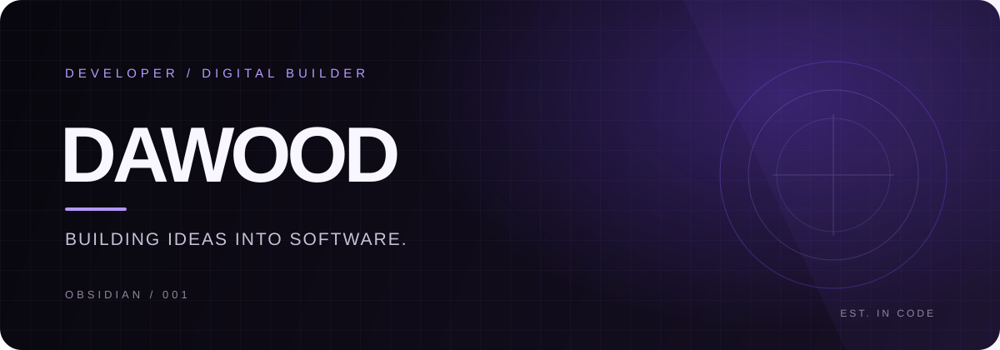
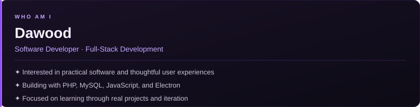
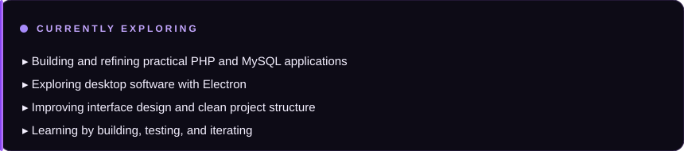

<!-- DAWOOD / OBSIDIAN PROFILE -->

---

### BUILDING THE DIGITAL WORLD, ONE PROJECT AT A TIME.

Developer focused on practical software, thoughtful interfaces, and turning ambitious ideas into working products.

### `👾 whoami`

> *"Code. Create. Inspire."*

### `⚡ currently exploring`

### `🛠️ tech stack`

**Backend & Database:** PHP · MySQL  
**Frontend:** HTML · CSS · JavaScript · Tailwind CSS  
**Desktop:** Electron  
**Tools:** Git · GitHub · VS Code

### `🚀 selected work`

**AETHER — Desktop AI Assistant**  
An experimental Electron desktop assistant exploring desktop interaction and Windows automation.

STATUS: IN DEVELOPMENT

**PHP / MySQL Applications**  
Building database-backed web applications with PHP, MySQL, and modern frontend tooling.

FOCUS: FULL-STACK DEVELOPMENT

### `🐍 contribution snake`

### `📊 contribution graph`

### `🤝 connect`

 

*Thanks for visiting — always learning, building, and improving.* ✦

DAWOOD · OBSIDIAN EDITION

